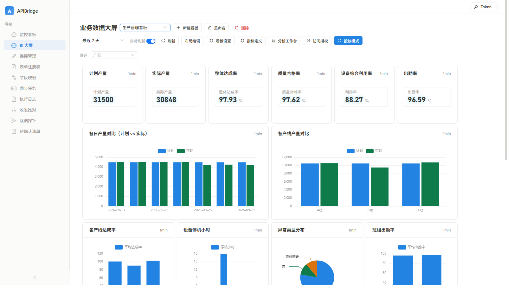
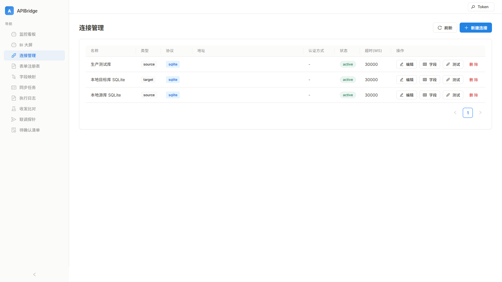
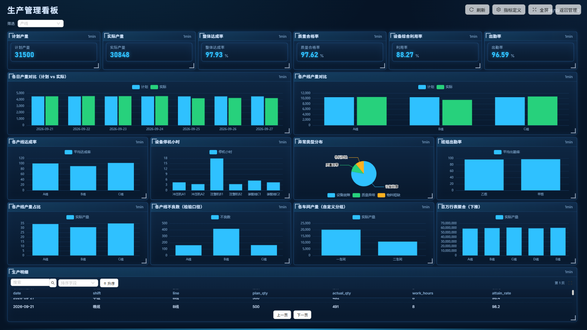
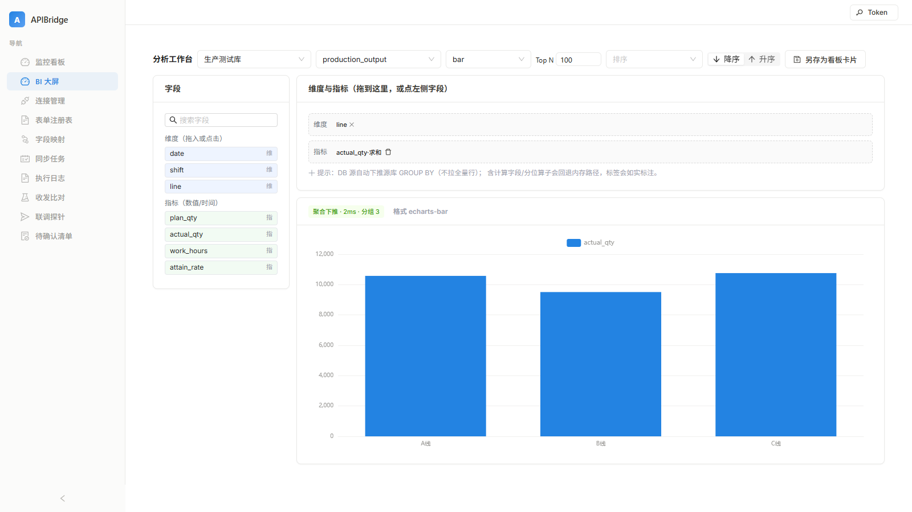
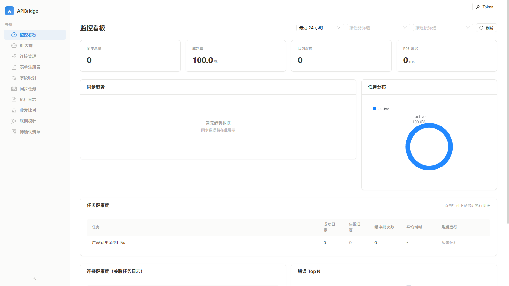

# APIBridge

<div align="center">

**数据交换平台 · 源/目标端数据持续同步 · 内置 BI 大屏**

[简体中文](README.md) | [English](README.en.md)



*BI 生产管理看板：KPI + 多维图表 + 聚合下推（百万行毫秒级）*

</div>

---

## 这是什么

**APIBridge 是一个数据交换平台**：让源系统与目标系统之间的业务数据**持续同步**——新增、变更、删除都会被捕获并落到目标端。它不是一次性的 API 调试工具或搬运脚本，而是"连得上 → 转得对 → 持续对齐"的完整链路：

1. **连得上**：统一管理 API 与数据库两端的连接，凭据加密存储，探针先验证再建桥；
2. **转得对**：字段映射 + 字段字典 + 逐条转换，L1/L2/L3 三级验证语义不谎报；
3. **持续对齐**：全量 / 增量（水位线）/ 删除对账三种模式，配 Cron 调度与 Webhook 触发。

在同步能力之上，内置一套 **BI 大屏与分析**：连接里的业务数据直接变成指标卡片、图表看板与对外投放页，无需第三方 BI。

## 功能总览

### 1. 数据同步核心



- **连接管理**：REST / SOAP / GraphQL / WebSocket / gRPC / Dubbo / 明道云 等 API 协议，Oracle / MySQL / PostgreSQL / SQLite 数据库；凭据 `enc:` 加密存储、输出统一脱敏。
- **同步任务**：全量、增量（水位线三重校验 + 轮次/租约/断点重试）、**删除对账**（按业务键差集清理目标端，含完整源集合守卫）；Cron 调度、Webhook 触发（强制 secret）、失败转异步、幂等短路。
- **字段映射与字典**：双栏字段选择、类型兼容校验、字段级 readable/writable 控制；同名退化映射 + 确定性校验。
- **执行日志**：逐条请求/响应/错误详情，失败行与字段级原因下钻。

### 2. 建桥流程（探针 → 待确认清单）

平台内唯一的建桥通路是「**提议 → 校验 → 人工批准**」：

- **L1** 连通性 / **L2** 转换正确性（不写目标）/ **L3** 端到端（需人工授权，写 1 条真实数据回读比对）；
- Schema 推断 + 映射草稿（无模型退化为同名 + 类型兼容）；
- 待确认清单批准后单事务创建 连接 + 映射 + 任务——AI agent 与探针不可直接建桥。

### 3. BI 大屏与分析



- **指标定义**：维度 / 度量 / 过滤 / 计算字段（行级表达式引擎）/ 聚合比 / 维度分组 / TopN，类型感知校验；
- **聚合引擎**：时间桶预聚合 + 水位线增量推进；DB 源大表自动**聚合下推**（百万行毫秒级，SQL 单一执行点、标识符白名单 + 全值绑定，可关闭）；
- **看板**：72×36 自由画布、多看板、维度筛选下发、布局编辑；
- **投放模式**：对外大屏（深浅主题、视口适配四模式、明细自动轮播），支持**只读访问授权**——令牌哈希存储 + 看板白名单 + 行过滤 + 列隐藏，服务端强制；
- **分析工作台**：字段树 + 拖拽即席出图 + 另存为看板卡片。



*分析工作台：聚合下推 2ms 出图，可另存为看板卡片*

### 4. 监控与运维



- 监控看板：任务/连接健康度、延迟 P95、失败原因归一化 Top N；
- Prometheus `/metrics` + Grafana 示例配置；
- 执行日志、收发比对、探针会话管理。

### 5. 安全

- 凭据 Fernet 加密（`enc:`），密钥仅存本地 `.env`；
- 管理令牌 + BI 只读令牌分离，写端点默认拒绝；
- Webhook 强制 secret（恒定时间比较）；探针 SSRF 防线（DNS 预解析 + 内网段拒绝 + 白名单豁免）。

## 快速开始

### 方式一：Windows 便携包（开箱即用）

包内自带 Python 3.12 运行时、Redis、Oracle Instant Client 19 与已编译前端，无需安装环境：

```cmd
start.cmd       rem 启动（后端 + Redis + 前端）
status.cmd      rem 查看状态
stop.cmd        rem 停止
```

打开 `http://127.0.0.1:3000`，将 `.env` 中 `APIBRIDGE_ADMIN_TOKEN=` 的值填入页面右上角「Token」。首次启动自动生成随机令牌与加密密钥；备份时同时保留 `.env`、`launcher.json` 与 `data\`。

### 方式二：源码运行

```bash
pip install -r requirements.txt
uvicorn app.main:app --host 127.0.0.1 --port 8000          # 后端
cd frontend-source && npm ci && npm run dev                 # 前端（开发）
cd frontend-source && npm ci && npm run build               # 前端（构建产物落 web/）
```

### 方式三：Docker

`docker-compose.yml` 提供 app + PostgreSQL + Redis 编排。

## 测试与质量

```bash
python -m pytest tests/ -q     # 1144 passed / 13 skipped（自足：临时 SQLite + 测试密钥）
```

- 五轮代码审查闭环（4 P0 + 23 P1 + 38 P2/P3，含对修复 diff 的复审），记录见 `MERGE-REPORT.md` §3.1–3.4；
- PostgreSQL 部署级真机验证 + 明道云 API 参数矩阵实测，见 `VALIDATION.md`；
- 验证语义诚实：`L2_partial_no_contract` 不算达标，测试不 mock 核心链路。

## 文档索引

| 文档 | 内容 |
|------|------|
| `AGENTS.md` | 工程须知：硬约束、环境陷阱清单、代码地图 |
| `docs/bi-dashboard-guide.md` | BI 大屏使用说明 |
| `docs/trial-guide.md` | 试用阶段须知（当前阶段：**开发冻结、测试试用**） |
| `incremental-sync.md` 等 | 同步专项说明 |
| `MERGE-REPORT.md` / `VALIDATION.md` | 审查与验证记录 |
| `openspec/` | 13 个能力域规格基线 |

## 目录结构

```
app/               后端（FastAPI：api / adapters / connectors / probe / services / security）
frontend-source/   前端源码（React 19 + antd v5 + ECharts）
tests/             pytest 全量测试
openspec/          能力域规格基线
docs/              设计与使用说明（含截图）
scripts/           冒烟与运维脚本
web/ runtime/ redis/ oracle/   便携包构建产物与运行时
```

## Windows 便携包要点

- 解压到**可写英文目录**；无 VC++ 运行库先安装 `prerequisites\VC_redist.x64.exe`；
- Oracle 默认 thick 模式兼容 11g（Instant Client 19 随包）；仅连 12.1+ 可改 `.env` 为 thin；
- 探针访问内网目标需在 `.env` 的 `APIBRIDGE_PROBE_ALLOWED_HOSTS` 加白名单；
- 升级旧目录：stop → 备份 `.env` / `launcher.json` / `data` → 拷入新包 → `migrate.cmd` → start；勿用新密钥覆盖旧 `.env`；
- 任务请用 `sync` 模式；`async` / 触发异步分支的 `auto` 需自行部署 RabbitMQ + Celery Worker；
- 便携包面向单机内网；Redis Windows 移植定位开发测试，高可用请用 Linux Redis。

## 当前阶段

**开发冻结、测试试用中**（自 2026-10-01）：试用期问题统一记录、集中修复，详见 `docs/trial-guide.md`。
