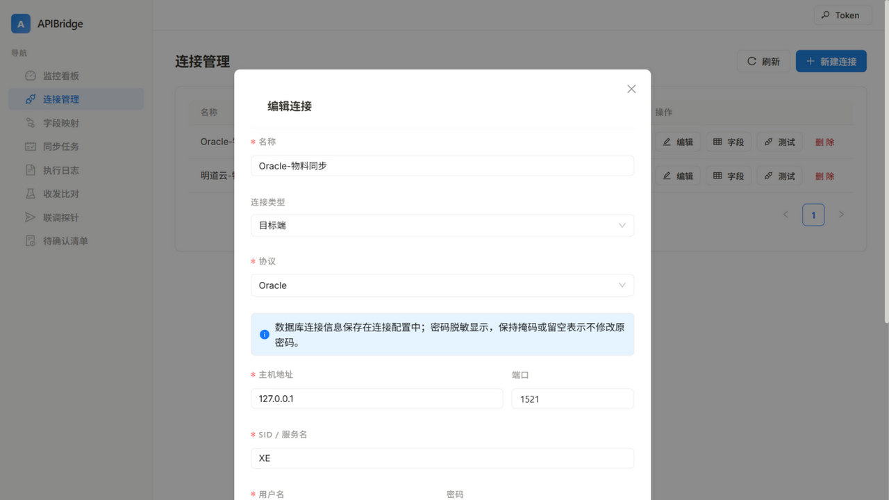
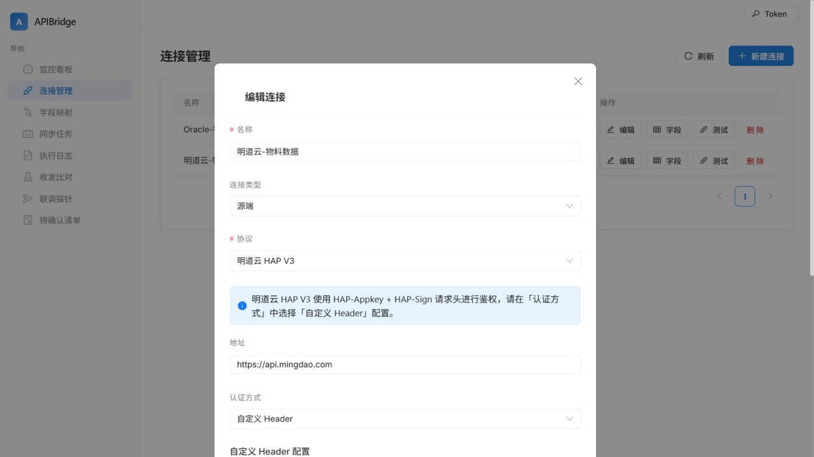
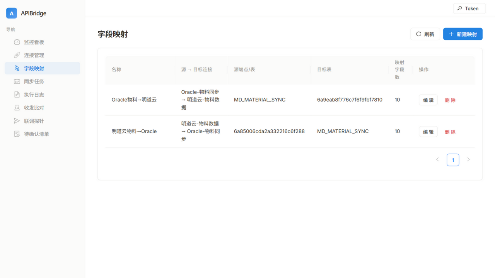
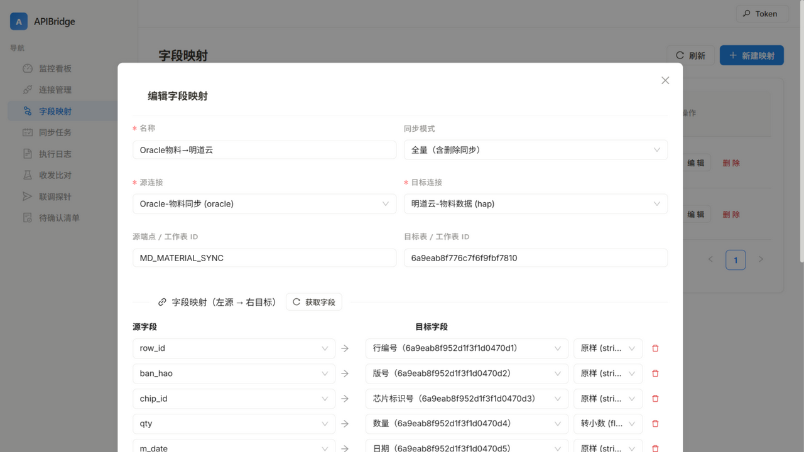
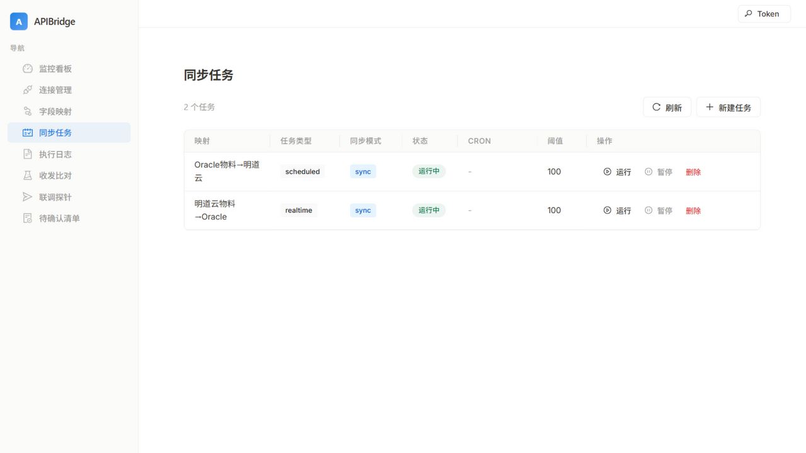
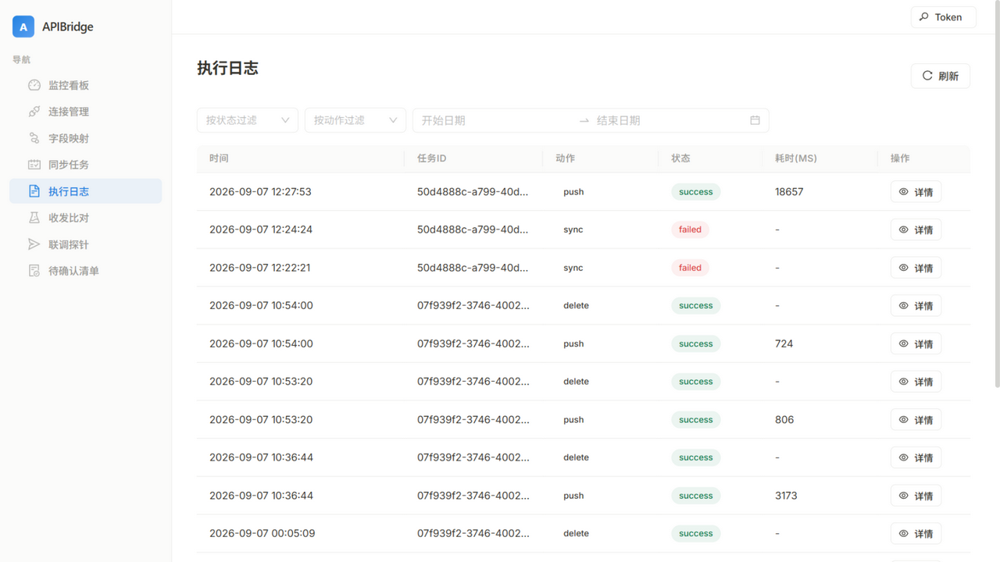

# 明道云 ↔ Oracle 双向数据同步操作指导

本指导覆盖两个同步方向的完整操作流程，全部操作在 APIBridge 管理界面完成：

| 方向 | 场景 | 数据流 |
|------|------|--------|
| **方向一：明道云 → Oracle** | 表单数据落地到数据库（持久化/分析） | 明道云工作表 → 抓取 → 字段转换 → Oracle 表 |
| **方向二：Oracle → 明道云** | 数据库数据回写表单（可视化/协同） | Oracle 表 → 抓取 → 字段转换 → 明道云工作表 |


> 核心思想：**同步由平台自动执行**。你只需要配置好"连接（怎么连）→ 字段映射（数据怎么对应）→ 同步任务（什么时候搬）"，数据搬运由系统完成，不需要人工导出导入。

---

## 0. 前置准备

### 0.1 启动服务

```bash
# 后端（端口 8000）。连 Oracle 11g 必须带 thick 两个环境变量
APIBRIDGE_ADMIN_TOKEN=<你的管理令牌> \
APIBRIDGE_DATABASE_URL="sqlite+aiosqlite:///./data/apibridge.db" \
APIBRIDGE_ORACLE_CLIENT_MODE=thick \
APIBRIDGE_ORACLE_CLIENT_LIB_DIR="E:\tools\instantclient\instantclient_19_25" \
python -m uvicorn app.main:app --host 127.0.0.1 --port 8000

# 前端（端口 3000）
cd frontend && npm run dev
```

### 0.2 登录管理界面

打开 `http://localhost:3000`，首次使用点击右上角 **Token** 按钮，输入启动后端时设置的管理令牌。

### 0.3 明道云开放凭据

在明道云应用的「API 开发文档」中获取：**appKey**、**sign**、**工作表 ID**、**视图 ID**。本文截图中的凭据已脱敏，请替换为你自己的值。明道云侧统一使用 **V2 版开放 API**（`/v2/open/worksheet/...`）。

---

## 1. 建立连接（两个方向通用）

连接只需建一次，两个方向复用。

### 1.1 新建 Oracle 连接

**连接管理 → 新建连接**，协议选 **Oracle**，表单切换为数据库配置区块：



| 字段 | 填写 | 示例 |
|------|------|------|
| 主机地址 | Oracle 服务器 IP | `127.0.0.1` |
| 端口 | 监听端口（默认 1521） | `1521` |
| SID / 服务名 | 实例名 | `XE` |
| 用户名 / 密码 | 数据库账号 | `system` / `******` |

保存前点 **「测试连接（不保存）」**，运行日志会显示探测过程（`SELECT 1` 探测、耗时、驱动报错），**status=ok 再保存**。

### 1.2 新建明道云连接

**连接管理 → 新建连接**，协议选 **明道云 HAP V3**：

- 地址填 `https://api.mingdao.com`
- 认证方式选 **自定义 Header**，添加两条：
  - `HAP-Appkey` = 你的 appKey
  - `HAP-Sign` = 你的 sign



同样先「测试连接（不保存）」再保存。

### 1.3 查看连接的字段定义

连接列表点 **字段** 按钮：

- **Oracle 连接**：打开即列出所有表，下拉选表查看列定义（类型/可空/主键）
- **明道云连接**：输入工作表 ID → 拉取全部控件（名称/ID/类型）

这一步用于建映射前**核对两端的字段名**。

---

## 2. 建立字段映射（核心步骤）

**字段映射 → 新建映射**：



1. **选择源连接、目标连接**（方向不同，两侧对调）
2. 填写端点：
   - 源为明道云 → 「源端点/工作表 ID」填工作表 ID
   - 目标为 Oracle → 「目标表」填表名（如 `MD_MATERIAL_SYNC`）
3. 点 **「获取字段」**，两侧字段自动拉取
4. 在双栏列表中逐行选择：**左边源字段 → 右边目标字段**。字段显示为 `名称（ID）` 格式，每行可选类型转换（原样/整数/小数）



5. 同步选项：
   - **主键字段**（目标侧）：用于按主键 upsert 去重
   - **删除同步**：源侧删除的行自动从目标删除（仅全量模式 + 数据库目标）
6. 保存

### 两个方向的映射要点

| | 方向一：明道云 → Oracle | 方向二：Oracle → 明道云 |
|---|---|---|
| 源字段 | 明道云控件 ID（下拉自动带出） | Oracle 列名（小写，下拉自动带出） |
| 目标字段 | Oracle 列名 | 明道云控件 ID（下拉自动带出） |
| 目标表 | Oracle 表名 | **明道云工作表 ID** |
| ⚠️ 关键配置 | 无 | 映射保存的 `protocol.worksheet_id` = 工作表 ID（界面上"目标表"字段填写即可自动带上） |

---

## 3. 建立同步任务并执行

**同步任务 → 新建任务**，选择刚建的映射，设置调度（cron）或手动触发，**同步方式选择 `sync`（同步执行）**——本机未部署消息队列时，`async` 模式会因连不上 RabbitMQ 而失败。



点 **执行** 后，到 **执行日志** 页查看结果：



---

## 4. 方向一实战：明道云表单 → Oracle

> 目标：把明道云「物料数据」表（26+ 行）自动落到 Oracle 表 `MD_MATERIAL_SYNC`。

### 4.1 目标表准备（Oracle 侧，一次性）

```sql
CREATE TABLE MD_MATERIAL_SYNC (
  ROW_ID        VARCHAR2(64) NOT NULL,   -- 明道云行 rowId，作为主键
  BAN_HAO       VARCHAR2(100),
  CHIP_ID       VARCHAR2(100),
  QTY           NUMBER,
  M_DATE        VARCHAR2(40),            -- 日期按字符串存，避免格式问题
  WAFER_BATCH   VARCHAR2(100),
  DICING_NO     VARCHAR2(100),
  QUALITY_GRADE VARCHAR2(50),
  BOX_NO        VARCHAR2(50),
  TEXT_COMB     VARCHAR2(500),
  PRIMARY KEY (ROW_ID)
);
```

### 4.2 配置与执行

1. 按第 2 节建映射：源=明道云连接 + 工作表 ID；目标=Oracle 连接 + `MD_MATERIAL_SYNC`；**主键字段选 `ROW_ID`**（源字段对应 rowId 的那一对）
2. 按第 3 节建任务并执行
3. 验证：Oracle 中 `SELECT COUNT(*)` 与明道云行数一致；重复执行任务不会产生重复数据（ROW_ID 主键 upsert）

### 4.3 增删改同步验证

- **新增**：明道云表单里加一行 → 再次执行任务 → Oracle 多一行
- **删除**：开启「删除同步」后，明道云删一行 → 执行任务 → Oracle 对应行被删除
- **变更**：改明道云某行字段值 → 执行任务 → Oracle 该行被 upsert 更新

---

## 5. 方向二实战：Oracle → 明道云

> 目标：把 Oracle 表数据回写到明道云应用里**新建的工作表**。

### 5.1 目标工作表准备（明道云侧）

调用明道云 V2 开放 API 新建工作表（注意：控件参数名是 **`controls`**）：

```bash
curl -X POST https://api.mingdao.com/v2/open/worksheet/addWorksheet \
  -H "Content-Type: application/json" \
  -d '{
    "appKey": "<你的appKey>", "sign": "<你的sign>", "appId": "<应用ID>",
    "name": "Oracle物料同步",
    "controls": [
      {"type": 2, "controlName": "行编号"},
      {"type": 2, "controlName": "版号"},
      {"type": 6, "controlName": "数量"},
      {"type": 2, "controlName": "日期"}
    ]
  }'
```

- 返回的 `data` 即**工作表 ID**（映射的"目标表"要填它）
- 控件类型：`2`=文本、`6`=数值；成功后到明道云界面确认表已出现

> ⚠️ 组织下工作表数量有免费版上限，试错建的表及时在明道云界面删除。

### 5.2 配置与执行

1. 按第 2 节建映射：源=Oracle 连接 + 表名；目标=明道云连接 + **新工作表 ID**；字段对按名称对应（平台会自动拉取控件，显示为 `名称（ID）`）
2. 按第 3 节建任务（**sync 模式**）并执行
3. 验证：
   - 明道云界面打开新工作表，行数应与 Oracle 一致
   - API 验证单行值（`getRowById` 为 **GET** 请求，返回里控件 ID 直接作为键）：

```
GET https://api.mingdao.com/v2/open/worksheet/getRowById
    ?appKey=...&sign=...&worksheetId=<工作表ID>&rowId=<行ID>
```

### 5.3 已知边界

- 明道云目标的写入是**追加式**（addRow）：重复执行任务会重复追加行，建议单次全量使用，或后续升级"按业务键去重"
- **删除同步暂不支持明道云目标**（仅数据库目标支持）：Oracle 删行后明道云不会自动删

---

## 6. 执行后核对清单

- [ ] 任务状态 `success`，执行日志无 failed 记录
- [ ] 目标端行数 = 源端行数
- [ ] 抽查一行：字段值逐项一致（类型转换生效，如数量为数值）
- [ ] 重复执行（方向一）不产生重复行

## 7. 常见问题

| 现象 | 处置 |
|------|------|
| Oracle 报 `DPY-3010` | 后端没开 thick 模式，见 0.1 启动参数 |
| Oracle 报 `DPI-1047` | `APIBRIDGE_ORACLE_CLIENT_LIB_DIR` 路径不对 |
| Oracle 突然连不上（`ORA-12541` 无监听） | 数据库跑在 WSL 容器时可能被空闲回收，`docker start apibridge-oracle-test` |
| 任务执行报"连接被拒绝"(WinError 10061) | 任务用了 async 模式但本机无 RabbitMQ，改用 sync 模式 |
| 映射保存/执行报"缺少 worksheet_id" | 目标为明道云时，"目标表"必须填工作表 ID |
| addWorksheet 报"控件数量不能为 0" | 参数名应为 `controls`，不是 `columns` |
| 明道云建表报"工作表数量已达上限" | 删除不用的表释放名额 |
| 界面按钮点了没反应 | 确认前端引入 `@ant-design/v5-patch-for-react-19`（React 19 兼容） |

---

*配套信息：架构设计见 [docs/apibridge_design.md](apibridge_design.md)；agent 自动化操作见 [AGENTS.md](../AGENTS.md) 与 `skills/` 目录。*
